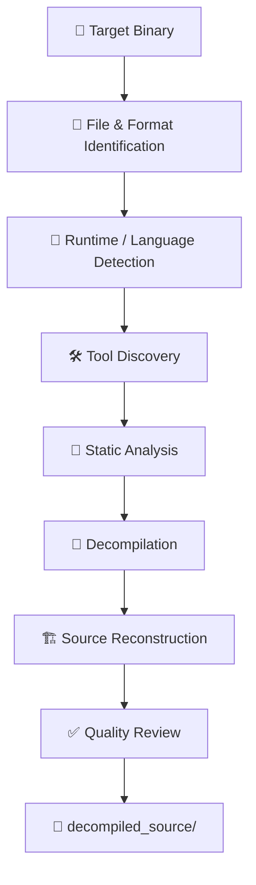

# Ultimate Reverser

<p align="center">
  
</p>

<h3 align="center">Advanced Static Reverse Engineering & Source Reconstruction</h3>

<p align="center">
  A powerful, tool-agnostic reverse-engineering skill for AI coding agents.
  <br />
  Analyze binaries. Reconstruct source code. Recover project structure.
</p>

<p align="center">
  <a href="https://github.com/t8n4/reverser-skill/stargazers">
    
  </a>
  <a href="https://github.com/t8n4/reverser-skill/network/members">
    
  </a>
  <a href="https://github.com/t8n4/reverser-skill/blob/main/LICENSE">
    
  </a>
  <a href="https://github.com/t8n4/reverser-skill">
    
  </a>
</p>

<p align="center">
  <a href="#features">Features</a> ·
  <a href="#installation">Installation</a> ·
  <a href="#usage">Usage</a> ·
  <a href="#supported-tools">Tools</a> ·
  <a href="#how-it-works">Workflow</a> ·
  <a href="#support">Support</a>
</p>

---

## Overview

**Ultimate Reverser** is a tool-agnostic reverse-engineering skill designed for AI coding agents. It analyzes executables, binaries, libraries and compiled packages to reconstruct the most complete and readable source representation possible.

It combines deep static analysis, format detection, decompilation and source reconstruction into one coordinated workflow.

Two operating modes are supported:

| Mode | Description |
|---|---|
| **REA Mode** | Uses REA MCP as the preferred reverse-engineering analysis backend. |
| **Standalone Mode** | Works independently with locally available static-analysis tools. |

Ultimate Reverser remains the central workflow orchestrator in both modes.

## Features

<table>
  <tr>
    <td width="50%">
      <h3>🔬 Deep Static Analysis</h3>
      Inspects binary structures, functions, symbols, references, control flow and data flow.
    </td>
    <td width="50%">
      <h3>🧩 Source Reconstruction</h3>
      Reconstructs readable source code and organizes recovered modules.
    </td>
  </tr>
  <tr>
    <td>
      <h3>📦 Multi-Format Support</h3>
      Identifies executable formats, libraries, packages, runtimes and languages.
    </td>
    <td>
      <h3>🔧 Tool-Agnostic</h3>
      Selects compatible analysis tools according to the target and environment.
    </td>
  </tr>
  <tr>
    <td>
      <h3>🔌 Optional REA Integration</h3>
      Connects to REA MCP for additional reverse-engineering capabilities.
    </td>
    <td>
      <h3>⚡ Standalone Operation</h3>
      Does not require REA when compatible local tools are available.
    </td>
  </tr>
  <tr>
    <td>
      <h3>🏗️ Architecture Recovery</h3>
      Attempts to reconstruct classes, functions, modules and dependencies.
    </td>
    <td>
      <h3>🛡️ Static-First Workflow</h3>
      Never executes the original target or reconstructed source.
    </td>
  </tr>
</table>

---

## Installation

Ultimate Reverser uses a lightweight Core installation. The installer copies the skill files without downloading large reverse-engineering applications.

### Windows

<details>
<summary><strong>PowerShell installation</strong></summary>

**Global installation:**

```powershell
irm https://raw.githubusercontent.com/t8n4/reverser-skill/main/install.ps1 | iex
```

**Project-local installation:**

```powershell
Invoke-WebRequest https://raw.githubusercontent.com/t8n4/reverser-skill/main/install.ps1 -OutFile install.ps1
.\install.ps1 -Scope Project
```

**Optional REA setup:**

```powershell
Invoke-WebRequest https://raw.githubusercontent.com/t8n4/reverser-skill/main/install.ps1 -OutFile install.ps1
.\install.ps1 -WithREA
```

</details>

### macOS / Linux

<details>
<summary><strong>Shell installation</strong></summary>

**Global installation:**

```bash
curl -fsSL https://raw.githubusercontent.com/t8n4/reverser-skill/main/install.sh | bash
```

**Project-local installation:**

```bash
curl -fsSL https://raw.githubusercontent.com/t8n4/reverser-skill/main/install.sh | bash -s -- --project
```

**Optional REA setup:**

```bash
curl -fsSL https://raw.githubusercontent.com/t8n4/reverser-skill/main/install.sh | bash -s -- --with-rea
```

</details>

### Installation behavior

- Installs `SKILL.md`, `knowledge/`, `workflows/` and `tools/`.
- Does not bulk-install Ghidra, JADX, ILSpy or other large applications.
- Does not configure REA unless explicitly requested.
- Backs up an existing Ultimate Reverser installation before replacing it.
- Does not intentionally modify unrelated OpenCode configuration.

Restart OpenCode after installation.

---

## Usage

Ultimate Reverser has two operating modes. Choose the appropriate prompt and send it to your AI coding agent.

### 1. REA Mode

Use this mode when you want REA MCP as the preferred analysis backend.

**Send this prompt to your agent:**

```text
Use the Ultimate Reverser skill.

First inspect whether REA is installed and connected to this coding agent. If missing or broken, prepare a detailed installation or repair plan for approval.

Show the exact commands and configuration changes before applying anything. Wait for my explicit approval.

After approval:
1. Install REA using `npx rea-agents@latest setup`.
2. Connect REA to OpenCode using the correct client configuration.
3. Use `--client opencode --skill=false` to prevent installation of REA's separate workflow skill.
4. Preserve existing configurations and create backups before modifying files.
5. Run REA doctor to verify the installation.
6. Restart or reconnect OpenCode and verify that REA MCP tools are actually available to the active coding agent.
7. If verification fails, diagnose the issue and present a repair plan for approval.

Ultimate Reverser must remain the sole workflow orchestrator. REA is only the preferred reverse-engineering analysis backend.

Do not analyze, execute, debug, or run any target executable or reconstructed source code during setup or verification.

Do not begin reverse engineering until the integration check is complete.

Do not claim success unless the live MCP connection has been verified.
```

### 2. Standalone Mode

Use this mode when you do not want REA and prefer locally available analysis tools.

**Send this prompt to your agent:**

```text
Use the Ultimate Reverser skill in standalone mode WITHOUT REA.

Do not install, download, configure, connect, or invoke REA. Do not use `npx rea-agents`, REA MCP, or any REA-related workflow.

First inspect the current coding agent environment and determine which static reverse-engineering tools are already installed and available.

Prepare a setup plan for approval:
1. Install or register Ultimate Reverser as the main skill.
2. Detect available static-analysis tools such as Ghidra, JADX, ILSpy, dnSpyEx, Detect It Easy, 7-Zip, file identification tools, and format-specific parsers.
3. Identify missing tools and explain which ones are genuinely necessary.
4. Show exact installation commands and configuration changes.
5. Wait for my explicit approval before making changes.

After approval:
1. Configure Ultimate Reverser to work independently.
2. Use available static-analysis tools as analysis providers.
3. Select tools dynamically according to the target format, language, runtime, and binary structure.
4. Verify that the skill is discoverable and that its available tools work.
5. Report unavailable capabilities honestly.

Ultimate Reverser must perform deep static analysis and reconstruct the best possible source representation.

STRICT RULES:
- Never install or use REA.
- Never execute the original target.
- Never execute reconstructed source code.
- Never use dynamic analysis, debugging, runtime instrumentation, or target execution.
- Do not fabricate recovered source code or claim exact source recovery without evidence.
- Do not bypass DRM, licensing, authentication, or access controls.
- Preserve the original target file.
- Output only the `decompiled_source` directory containing reconstructed source and essential metadata.
- Do not generate analysis reports, logs, dumps, caches, or unrelated output folders.

Do not begin reverse engineering until the standalone installation and verification are complete.
```

---

## Supported Tools

Ultimate Reverser detects available tools and selects them according to target compatibility.

| Tool | Purpose |
|---|---|
| **REA MCP** | Reverse-engineering analysis backend |
| **Ghidra** | Native binary analysis and decompilation |
| **Rizin / radare2** | Native binary inspection |
| **RetDec** | Static decompilation for supported formats |
| **JADX** | Android APK / DEX analysis |
| **ILSpy** | .NET decompilation |
| **dnSpyEx** | .NET assembly inspection |
| **Detect It Easy** | File, compiler and packer identification |
| **7-Zip** | Archive and package inspection |

Tool availability depends on the host environment, installed dependencies and target format. Missing tools should be proposed individually rather than installed in bulk.

---

## How It Works



1. **Identification** — Determines format, architecture, runtime and likely language.
2. **Structural Analysis** — Examines headers, sections, metadata, symbols, imports and exports.
3. **Static Analysis** — Inspects functions, references, control flow and data flow.
4. **Decompilation** — Uses compatible tools to recover high-level representations.
5. **Reconstruction** — Organizes recovered code into readable files and modules.
6. **Quality Review** — Checks consistency, unresolved references and missing regions.
7. **Delivery** — Produces the reconstructed source directory.

---

## Output Structure

The final delivery is restricted to one directory:

```text
decompiled_source/
├── src/
│   ├── reconstructed source files
│   └── modules/
├── resources/
│   └── recovered resources
└── metadata/
    └── essential reconstruction metadata
```

The exact structure depends on the target and the information that can be recovered.

Temporary analysis databases, logs, caches, unrelated reports and dumps are excluded from the final delivery.

---

## Safety & Limitations

Ultimate Reverser follows a static-first reconstruction workflow.

- Original executables are never executed.
- Reconstructed source code is never executed.
- No dynamic debugging or runtime instrumentation is performed.
- Original target files are preserved.
- DRM, licensing, authentication and access-control bypasses are outside the intended scope.
- Credentials and secrets are not extracted.
- Missing source code is never fabricated.

**Recovery is not guaranteed to be identical to the original source.** Compilation and obfuscation can permanently remove comments, formatting, original variable names and high-level structures.

Results depend on the target format, compiler, optimization level, symbols, metadata and available analysis tools.

---

## Support

<p align="center">
  <strong>Enjoying Ultimate Reverser?</strong>
  <br />
  If this project saves you time or improves your workflow, consider supporting its development.
</p>

<p align="center">
  <a href="https://buymeacoffee.com/t8n4">
    
  </a>
</p>

<p align="center">
  Every contribution helps support future improvements and development.
</p>

---

## License

See [LICENSE](LICENSE) for licensing terms.

<p align="center">
  <strong>Ultimate Reverser</strong>
  <br />
  <em>Analyze deeply. Reconstruct accurately. Stay static.</em>
  <br /><br />
  <a href="https://github.com/t8n4/reverser-skill">GitHub Repository</a>
  ·
  <a href="https://buymeacoffee.com/t8n4">Support Development</a>
</p>