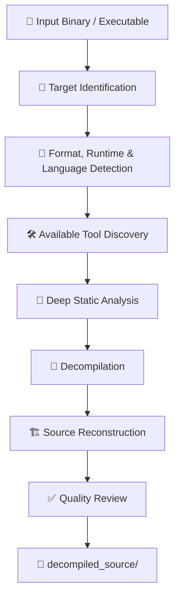

# Ultimate Reverser

<p align="center">
  
</p>

<p align="center">
  <strong>Advanced Static Reverse Engineering & Source Reconstruction Skill</strong>
</p>

<p align="center">
  A powerful, tool-agnostic reverse-engineering skill designed for AI coding agents.
  Analyze binaries, reconstruct source code, and deliver clean results.
</p>

<p align="center">
  <a href="https://github.com/t8n4/reverser-skill/stargazers">
    
  </a>
  <a href="https://github.com/t8n4/reverser-skill/network/members">
    
  </a>
  <a href="https://github.com/t8n4/reverser-skill/blob/main/LICENSE">
    
  </a>
  <a href="https://github.com/t8n4/reverser-skill">
    
  </a>
</p>

---

## ✨ Features

| Feature | Description |
|---|---|
| 🔬 **Deep Static Analysis** | Inspects binary structures, functions, symbols, references, control flow, and data flow. |
| 🧩 **Source Reconstruction** | Reconstructs readable source code from supported compiled formats. |
| 📦 **Multi-Format Support** | Identifies executable formats, libraries, packages, runtimes, and programming languages. |
| 🔧 **Tool-Agnostic Architecture** | Selects available analysis tools according to the target format and environment. |
| 🔌 **REA Integration** | Optionally connects to REA MCP for advanced reverse-engineering capabilities. |
| ⚡ **Standalone Mode** | Works without REA by using available local analysis tools. |
| 🧠 **Runtime & Compiler Detection** | Identifies likely languages, frameworks, compilers, and runtime environments. |
| 🏗️ **Architecture Reconstruction** | Attempts to recover modules, classes, functions, dependencies, and relationships. |
| 📁 **Source-Only Delivery** | Keeps the final output focused on reconstructed source code. |
| 🛡️ **Safety-First Workflow** | Uses static analysis only; never executes the target or reconstructed code. |

---

## 📦 Installation

Ultimate Reverser now uses a **lightweight Core installation**.

The initial installation only copies the skill files. Large analysis tools are not downloaded, and REA is not configured unless you explicitly request it.

### ⚡ Quick Installation

<details>
<summary><strong>🪟 Windows — PowerShell</strong></summary>

**Global installation:**

```powershell
irm https://raw.githubusercontent.com/t8n4/reverser-skill/main/install.ps1 | iex
```

**Project-local installation:**

```powershell
Invoke-WebRequest https://raw.githubusercontent.com/t8n4/reverser-skill/main/install.ps1 -OutFile install.ps1
.\install.ps1 -Scope Project
```

**Optional REA installation:**

```powershell
Invoke-WebRequest https://raw.githubusercontent.com/t8n4/reverser-skill/main/install.ps1 -OutFile install.ps1
.\install.ps1 -WithREA
```

</details>

<details>
<summary><strong>🐧 macOS / Linux</strong></summary>

**Global installation:**

```bash
curl -fsSL https://raw.githubusercontent.com/t8n4/reverser-skill/main/install.sh | bash
```

**Project-local installation:**

```bash
curl -fsSL https://raw.githubusercontent.com/t8n4/reverser-skill/main/install.sh | bash -s -- --project
```

**Optional REA installation:**

```bash
curl -fsSL https://raw.githubusercontent.com/t8n4/reverser-skill/main/install.sh | bash -s -- --with-rea
```

</details>

After installation, restart OpenCode to load the skill.

### ⚙️ What the Installer Does

| Component | Initial installation |
|---|---|
| Ultimate Reverser Core |  |
| Knowledge files |  |
| Workflow files |  |
| Tool detection |  |
| REA MCP |  |
| Ghidra / JADX / ILSpy |  |

**Installation principles:**

- Lightweight Core installation.
- No bulk downloading of analysis tools.
- REA remains optional.
- External tools are detected when needed.
- Missing tools are proposed individually.
- User approval is required before optional setup or external tool installation.
- Existing skill installations are backed up before replacement.
- Unrelated OpenCode configuration is not intentionally modified.

For additional details, see [INSTALL.md](INSTALL.md).

---

## 🔌 Operating Modes

Ultimate Reverser supports two operating modes.

### 1. With REA

Integrates with REA as the preferred reverse-engineering analysis backend through MCP.

Use this prompt in your coding agent:

```text
Use the Ultimate Reverser skill.

First inspect whether REA is installed and connected to this coding agent. If missing or broken, prepare a detailed installation or repair plan for approval.

Show the exact commands and configuration changes before applying anything. Wait for my explicit approval.

After approval:
1. Install REA using `npx rea-agents@latest setup`.
2. Connect REA to OpenCode using the correct client configuration.
3. Use `--client opencode --skill=false` to prevent installation of REA's separate workflow skill.
4. Preserve existing configurations and create backups before modifying files.
5. Run REA doctor to verify the installation.
6. Restart or reconnect OpenCode and verify that REA MCP tools are actually available to the active coding agent.
7. If verification fails, diagnose the issue and present a repair plan for approval.

Ultimate Reverser must remain the sole workflow orchestrator. REA is only the preferred reverse-engineering analysis backend.

Do not analyze, execute, debug, or run any target executable or reconstructed source code during setup or verification.

Do not begin reverse engineering until the integration check is complete.

Do not claim success unless the live MCP connection has been verified.
```

### 2. Without REA — Standalone Mode

Operates independently using locally available static-analysis tools.

Use this prompt:

```text
Use the Ultimate Reverser skill in standalone mode WITHOUT REA.

Do not install, download, configure, connect, or invoke REA. Do not use `npx rea-agents`, REA MCP, or any REA-related workflow.

First inspect the current coding agent environment and determine which static reverse-engineering tools are already installed and available.

Prepare a setup plan for approval:
1. Install or register Ultimate Reverser as the main skill.
2. Detect available static-analysis tools such as Ghidra, JADX, ILSpy, dnSpyEx, Detect It Easy, 7-Zip, file identification tools, and format-specific parsers.
3. Identify missing tools and explain which ones are genuinely necessary.
4. Show exact installation commands and configuration changes.
5. Wait for my explicit approval before making changes.

After approval:
1. Configure Ultimate Reverser to work independently.
2. Use available static-analysis tools as analysis providers.
3. Select tools dynamically according to the target format, language, runtime, and binary structure.
4. Verify that the skill is discoverable and that its available tools work.
5. Report unavailable capabilities honestly.

Ultimate Reverser must perform deep static analysis and reconstruct the best possible source representation.

STRICT RULES:
- Never install or use REA.
- Never execute the original target.
- Never execute reconstructed source code.
- Never use dynamic analysis, debugging, runtime instrumentation, or target execution.
- Do not fabricate recovered source code or claim exact source recovery without evidence.
- Do not bypass DRM, licensing, authentication, or access controls.
- Preserve the original target file.
- Output only the `decompiled_source` directory containing reconstructed source and essential metadata.
- Do not generate analysis reports, logs, dumps, caches, or unrelated output folders.

Do not begin reverse engineering until the standalone installation and verification are complete.
```

---

## 🛠️ Supported Analysis Tools

Ultimate Reverser detects and uses tools according to availability and target compatibility.

| Tool | Primary purpose |
|---|---|
| 🔌 **REA MCP** | Reverse-engineering analysis backend |
| 🧠 **Ghidra** | Binary analysis and decompilation |
| 📱 **JADX** | Android APK / DEX analysis |
| 🟣 **ILSpy** | .NET decompilation |
| 🔍 **dnSpyEx** | .NET assembly inspection |
| 🧪 **Detect It Easy** | File type, compiler, and packer detection |
| 📦 **7-Zip** | Archive and package inspection |
| ⚙️ **Rizin / radare2** | Native binary inspection |
| 🧬 **RetDec** | Static decompilation for supported formats |

*Tool availability and supported capabilities depend on the host environment and target format.*

---

## 🔍 How It Works



1. **Target Identification** — Determines file format, architecture, runtime, and likely programming language.
2. **Structural Analysis** — Examines headers, sections, metadata, symbols, imports, and exports.
3. **Static Analysis** — Analyzes functions, references, control flow, and data flow.
4. **Decompilation** — Uses compatible tools to recover high-level representations.
5. **Source Reconstruction** — Organizes recovered code into readable source files and modules.
6. **Quality Review** — Checks consistency, missing sections, unresolved references, and reconstruction limitations.
7. **Delivery** — Produces the final `decompiled_source` directory.

---

## 📁 Output Structure

The final delivery is restricted to one directory:

```text
decompiled_source/
├── src/
│   ├── reconstructed source files
│   └── modules/
├── resources/
│   └── recovered resources
└── metadata/
    └── essential reconstruction metadata
```

The actual structure depends on the target format and the information that can be recovered.

No unrelated analysis reports, temporary dumps, tool databases, or caches are included in the final delivery.

---

## 🔒 Safety & Limitations

Ultimate Reverser follows a static-first, source-reconstruction workflow.

- Original executables are never executed.
- Reconstructed source code is never executed.
- No dynamic debugging or runtime instrumentation is performed.
- Original target files are preserved.
- DRM, licensing, authentication, and access-control bypasses are outside the intended scope.
- Sensitive information and secrets are not extracted.
- Unrecoverable code is not fabricated.

> **Important:** Decompiled code is not guaranteed to match the original source code. Original comments, formatting, variable names, and some high-level structures may be permanently lost during compilation or obfuscation.

Reconstruction quality depends on the target format, compiler, optimization level, symbols, metadata, and available analysis tools.

---

## ⚙️ Requirements

- An AI coding agent that supports skills, such as OpenCode.
- The Ultimate Reverser skill files.
- Compatible static-analysis tools for the target format.
- Node.js and npm when using the REA installation workflow.
- REA is optional.

---

## ☕ Support the Project

<p align="center">
  <strong>Enjoying Ultimate Reverser?</strong>
  <br />
  If this project saves you time or helps your workflow, consider supporting its development.
</p>

<p align="center">
  <a href="https://buymeacoffee.com/t8n4">
    
  </a>
</p>

<p align="center">
  Every contribution helps support future improvements, maintenance, and development.
</p>

---

## 📄 License

See the repository's [LICENSE](LICENSE) file for licensing terms.

---

<p align="center">
  <strong>Ultimate Reverser</strong>
  <br />
  <em>Analyze deeply. Reconstruct accurately. Stay static.</em>
  <br /><br />
  <a href="https://github.com/t8n4/reverser-skill">GitHub Repository</a>
  ·
  <a href="https://buymeacoffee.com/t8n4">Support Development</a>
</p>